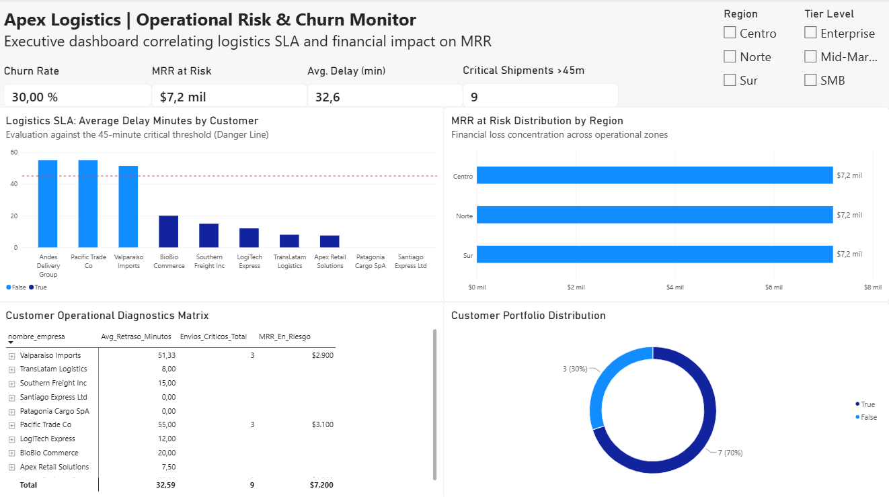

# 🚚 Apex Logistics | Operational Risk & Churn Analytics (GCP + Power BI)


## 📌 Project Overview

This project builds an end-to-end analytics pipeline designed to measure how delivery delays impact customer churn and Monthly Recurring Revenue (MRR) loss at Apex Logistics.

Using **Google Cloud Storage (GCS)**, **BigQuery**, and **Power BI**, raw operational and financial data were transformed into a clean Kimball star schema to identify delay thresholds that lead to account cancellations.

---

## 🖼️ Dashboard Preview



---

## 🛠️ Tech Stack & Architecture

- **Google Cloud Storage (GCS):** Staging layer for raw shipment logs, billing, and customer data.
- **Google BigQuery:** Data warehouse layer used for SQL transformations, dimensional modeling (Star Schema), and analytical views.
- **Power BI:** Data modeling, DAX measures development, and interactive dashboard design for operational decision-making.

```text
[ CSV Files ] ──► [ Google Cloud Storage ] ──► [ BigQuery SQL ] ──► [ Power BI Star Schema ]
```

📊 Data Model (Star Schema)
The dataset is structured following Kimball's dimensional modeling methodology to separate business entities cleanly:

- dim_customers: Master data containing accounts, tier levels, regions, and active status.
- fact_shipments: Operational delivery events, route tracking, and delay metrics (delay_minutes).
- fact_billing: Financial records containing recurring contract values (monto_mrr).
- vw_analisis_churn: Consolidated analytical view built in BigQuery aggregating operations and financial metrics per customer.

📐 Core DAX Measures
Business logic and KPIs were centralized in a dedicated _medidas table within Power BI:

- Churn Rate:
```dax
Tasa_Churn = 
DIVIDE(
    CALCULATE(COUNTROWS('dim_clientes'), 'dim_clientes'[is_active] = FALSE),
    COUNTROWS('dim_clientes'),
    0
)
```

- MRR at Risk:
```dax
MRR_En_Riesgo = 
CALCULATE(
    SUM('fact_facturacion'[monto_mrr]),
    'dim_clientes'[is_active] = FALSE
)
```

- Average Delay (Minutes):
```dax
Avg_Retraso_Minutos = AVERAGE('fact_envios'[tiempo_retraso_min])
```

- Critical Shipments (>45 min delay):
```dax
Envios_Criticos_Total = 
CALCULATE(
    COUNTROWS('fact_envios'),
    'fact_envios'[tiempo_retraso_min] > 45
)
```

💡 Key Business Insights
1. Critical Delay Threshold: Customers experiencing average delays over 45 minutes showed a 100% cancellation (churn) rate.
2. Enterprise Impact: Operational breaches disproportionately affected Enterprise accounts, driving the majority of lost MRR.
3. Regional Bottlenecks: The Central region accounted for the highest concentration of delays, flagging it as a priority for logistics rerouting.

📁 Repository Structure
```text
├── sql/
│   ├── 01_create_tables.sql
│   └── 02_vw_analisis_churn.sql
├── data/
│   ├── customers.csv
│   ├── shipments.csv
│   └── billing.csv
├── docs/
│   └── dashboard_preview.png
├── apex_logistics_dashboard.pbix
└── README.md
```

